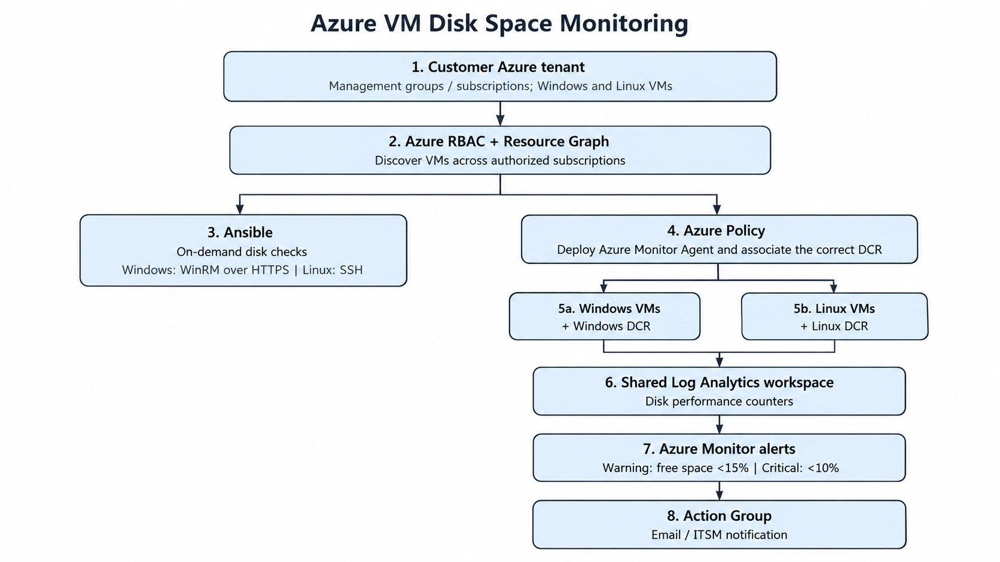

# Azure VM Disk Space Monitoring

## Goal

Detect low disk space on Azure Windows and Linux VMs before it causes an outage. Use Azure-native monitoring for continuous collection and keep Ansible for manual checks.

## Architecture



### How it works

1. Azure Resource Graph lists Windows and Linux VMs across the subscriptions in scope.
2. Azure Policy helps onboard existing and new VMs by deploying Azure Monitor Agent(AMA) and associating the right Data Collection Rule (DCR).
3. AMA -  collects disk free-space counters. Use separate DCRs because Windows and Linux counter names differ.
4. Both DCRs send data to one "Log Analytics workspace", in the `Perf` table.
5. Azure Monitor scheduled-query alerts use the KQL examples in `kql/` and send notifications through an Action Group.
6. Ansible is for on-demand checks and troubleshooting; it does not poll every VM continuously.

## Access and security

- Give the discovery identity Reader access to the subscriptions that are in scope.
- Limit who can assign Azure Policy and change DCRs, alerts, and workspace settings through Azure RBAC.
- Use the VM's managed identity for Azure Monitor Agent. Do not store workspace keys or monitoring passwords on VMs.
- Run Ansible from an approved management network. Use WinRM over HTTPS for Windows and SSH for Linux; do not expose management ports to the public internet.
- Store Ansible credentials in Ansible Vault or AWX/AAP credentials. Do not commit secrets to Git.

## VM discovery and enrollment

In Azure Resource Graph Explorer, select the subscriptions to monitor and run:

```kusto
Resources
| where type =~ 'microsoft.compute/virtualmachines'
| extend osType = tostring(properties.storageProfile.osDisk.osType)
| where osType =~ 'Windows' or osType =~ 'Linux'
| project name, subscriptionId, resourceGroup, location, osType, id
| order by subscriptionId asc, osType asc, name asc
```

Resource Graph shows which VMs exist; it does not install monitoring. After the pilot works, assign the appropriate built-in Azure Policy initiative for AMA deployment and DCR association at the management-group or subscription scope. Use the Windows policy/DCR for Windows VMs and the Linux policy/DCR for Linux VMs, then remediate existing VMs and check policy compliance.

## Disk data and alerts

Create one shared Log Analytics workspace and two DCRs with a 60-second sample interval:

| DCR | Performance counters |
|---|---|
| Windows | `\\LogicalDisk(*)\\% Free Space`; `\\LogicalDisk(*)\\Free Megabytes` |
| Linux | `\\Logical Disk(*)\\% Free Space`; `\\Logical Disk(*)\\Free Megabytes` |

Send both DCRs to the workspace using the `Microsoft-Perf` stream. The samples in `kql/` query the shared `Perf` table.

- Warning: free space below 15%.
- Critical: free space below 10%.

These thresholds are examples for the assessment. Create a scheduled-query alert for each query and connect both to an Action Group (for example, email or the existing incident process). `disk-overview.kql` can be used in a simple Azure Monitor Workbook to display the latest reading by VM and drive/mount point.

## Ansible examples

The playbooks demonstrate a simple spot check and can be run after replacing the sample inventory with reachable test VMs:

```bash
ansible-playbook -i ansible/inventory.ini.example ansible/check-windows-disks.yml
ansible-playbook -i ansible/inventory.ini.example ansible/check-linux-disks.yml
```

The Windows playbook uses WinRM over HTTPS; the Linux playbook uses SSH. Both report disk free space and Azure Monitor Agent service status. Keep credentials outside the inventory file.

## Scaling

Use Azure Resource Graph to review VMs across subscriptions and assign the relevant Azure Policy initiatives at management-group scope where possible, or per subscription otherwise. A shared workspace centralizes the metrics, and policy-based onboarding covers new VMs in scope without manually adding each VM to the monitoring configuration. Ansible remains an on-demand support tool.
